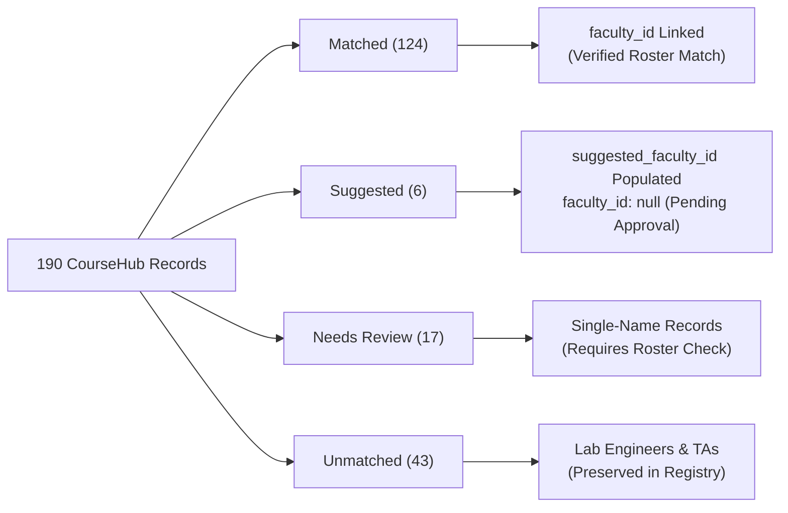
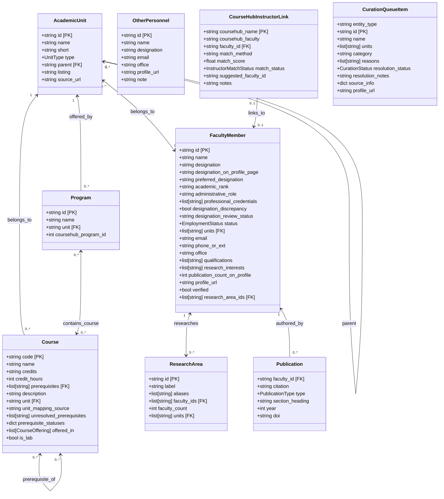
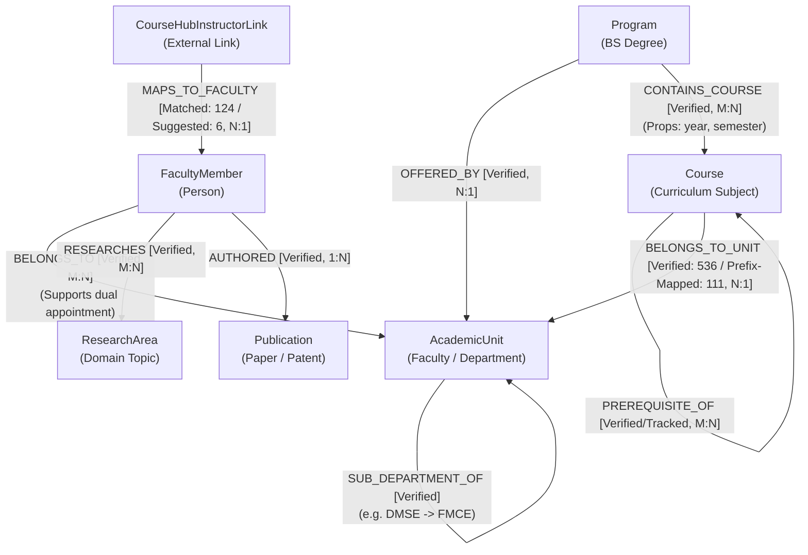

# GIKI Nexus: Complete Project Master Documentation & File Guide

**Document Version:** 2.0.0  
**Project:** GIKI Nexus — Academic & Research Discovery Platform with Teammate Matching  
**Environment:** Python 3.13 / Modular Engineering Foundation (Pre-Database Persistence)  
**Status:** Phase 1 & Data Curation Complete — Production Ready for Database & Graph Modeling  
**Test Suite:** 18/18 Unit Tests Passing (100% Pass Rate)  
**Validation Outcome:** 0 Errors, 0 Warnings across 647 Courses, 181 Faculty, 9 Units, 2,796 Publications, 656 Research Areas, 15 Programs, 20 Personnel, and 190 Instructor Links.

---

## 1. Executive Summary & Project Purpose

### 1.1 What is GIKI Nexus?
**GIKI Nexus** is an institutional academic and research discovery platform designed specifically for the Ghulam Ishaq Khan Institute of Engineering Sciences and Technology (GIKI). It aims to connect students, faculty, and academic programs while establishing the architectural foundation for an intelligent, voluntary project teammate discovery system.

The project is structured into two primary functional components:

1. **Academic & Research Discovery:**
   - **Academic Navigation:** Explore GIKI faculties, departments, and degree programs.
   - **Faculty & Research Exploration:** Discover faculty members by academic rank, administrative role, normalized research domains, and verified publications.
   - **Curriculum Architecture:** Explore courses, credit hour breakdowns, prerequisites, and degree semester roadmaps.
   - **Knowledge Graph Foundation:** Model academic entities as a directed graph representing real-world university relationships (e.g. cross-department dual appointments).

2. **Project Teammate Discovery (Future Phase):**
   - **Voluntary Student Profiles:** Student-created profiles highlighting technical skills, academic interests, availability, and past project experience.
   - **Complementary Teammate Matching:** Intelligent recommendations linking students based on shared research areas and complementary skillsets.
   - **Privacy & Transparency:** Strict user-facing privacy controls and explainable matching rationales without exposing private academic data.

### 1.2 Core Engineering Constraints
To ensure software engineering rigor for this university project, the following core constraints are maintained:
- **Immutability of Raw Data:** Original raw JSON datasets (`data/raw/`) remain strictly read-only and bit-for-bit untouched.
- **Zero-Invention Policy:** Missing fields (e.g. unassigned course units, missing faculty emails) are never hallucinated, assumed, or filled with synthetic fake data.
- **CourseHub Decoupling:** CourseHub is a separate system. GIKI Nexus maintains an independent codebase, database, schema, backend, and frontend. CourseHub is consumed solely as static read-only JSON snapshots for cross-referencing.
- **Traceability & Provenance:** Source URLs, prospectus citations, and scrape timestamps are preserved on all entities.
- **Modular Pre-Persistence Design:** Data cleaning, normalization, validation, and domain modeling are completed using standard Python and Pydantic v2 schemas before introducing database drivers (PostgreSQL/SQLite/Neo4j).

---

## 2. Complete File-by-File Catalog

Below is an exhaustive directory and file guide detailing every file in the GIKI Nexus project repository.

```
GIKI-Nexus/
├── PROJECT_MASTER_DOCUMENTATION.md      # Master all-in-one project documentation (this document)
├── README.md                            # High-level overview, quickstart, and project summary
├── .gitignore                           # Git exclusion rules for Python, virtualenvs, datasets, cache
├── .gitattributes                       # Line ending and repository configuration
│
├── backend/                             # Core application backend
│   ├── app/
│   │   ├── __init__.py                  # Backend application package marker
│   │   ├── schemas/                     # Formal Pydantic v2 domain schemas
│   │   │   ├── __init__.py              # Schema exports
│   │   │   └── domain.py                # Strongly-typed models for all academic entities
│   │   ├── data_processing/             # Data audit, cleaning, validation, and curation engine
│   │   │   ├── __init__.py              # Processing package exports
│   │   │   ├── cleaner.py               # Text, credit, email, prefix, and designation normalizers
│   │   │   ├── validator.py             # Schema constraint, integrity, and foreign key validators
│   │   │   ├── entities.py              # Domain entity transformers & curation queue generator
│   │   │   └── pipeline.py              # Pipeline orchestrator (`DataPipeline`)
│   │   ├── api/routes/                  # [Scaffolded] Future REST / GraphQL API endpoints
│   │   ├── database/                    # [Scaffolded] Future database connections & repositories
│   │   ├── graph/                       # [Scaffolded] Future knowledge graph query engines
│   │   ├── models/                      # [Scaffolded] Future ORM / database entity models
│   │   └── services/                    # [Scaffolded] Future matching engine and business services
│   └── tests/                           # [Scaffolded] Future backend integration tests
│
├── data/                                # Data storage directories
│   ├── raw/                             # Original, untouched raw JSON files
│   │   ├── giki_scrape_raw.json         # Raw scrape container (201 profiles, 231 listings)
│   │   ├── units.json                   # 9 academic units (faculties & departments)
│   │   ├── faculty.json                 # 181 faculty member profiles
│   │   ├── courses.json                 # 647 courses from prospectus & CourseHub
│   │   ├── publications.json            # 2,893 raw publication citations
│   │   ├── research_areas.json          # 657 raw research interest topics
│   │   ├── programs.json                # 15 Bachelor of Science degree programs
│   │   ├── other_personnel.json         # 20 non-faculty personnel profiles
│   │   ├── coursehub_instructor_links.json # 190 CourseHub instructor name linkages
│   │   ├── needs_review.json            # 36 seed curation review items
│   │   └── build_report.json            # Seed extraction metadata
│   ├── processed/                       # Validated, deduplicated, standardized datasets
│   │   ├── units.json                   # 9 standardized academic units
│   │   ├── faculty.json                 # 181 faculty profiles (161 verified, 31 decomposed designations)
│   │   ├── courses.json                 # 647 courses (100% units mapped, prerequisites tracked)
│   │   ├── publications.json            # 2,796 clean citations (97 duplicates removed)
│   │   ├── research_areas.json          # 656 normalized areas (1 ID collision resolved)
│   │   ├── programs.json                # 15 degree programs cleanly linked to units
│   │   ├── other_personnel.json         # 20 non-faculty personnel cleanly isolated
│   │   ├── coursehub_instructor_links.json # 190 instructors categorized into 4 statuses
│   │   ├── needs_review.json            # 378 structured curation items (resolved/needs_review/info)
│   │   └── processing_report.json       # Pipeline execution report and validation summary
│   └── sample/                          # Rapid-prototyping sample subset
│       ├── units.json                   # 2 units (FCSE, FEE)
│       ├── faculty.json                 # 5 verified faculty members
│       ├── courses.json                 # 8 curriculum courses
│       ├── publications.json            # 10 publication citations
│       ├── research_areas.json          # 10 research areas
│       └── programs.json                # 3 degree programs
│
├── docs/                                # Project documentation
│   ├── data_audit_report.md             # Comprehensive data audit report (v2.0.0)
│   ├── data_dictionary.md               # Field-by-field schema dictionary (v2.0.0)
│   ├── initial_development_log.md       # Development history and architectural decision log
│   ├── project_overview_and_file_guide.md # File guide and overview
│   ├── design/                          # System design documentation
│   │   ├── domain_models.md             # Pydantic domain models & Mermaid class diagram
│   │   ├── academic_relationships.md    # Knowledge graph relationship architecture & edge rules
│   │   └── data_mapping_review.md       # Complete mapping tables & curation action plan
│   ├── requirements/                    # [Scaffolded] Future PRDs
│   ├── testing/                         # [Scaffolded] Future test plans
│   └── project-management/              # [Scaffolded] Future sprint plans
│
├── scripts/                             # Executable CLI utility scripts
│   ├── run_pipeline.py                  # Orchestrates full data cleaning & validation pipeline
│   ├── validate_data.py                 # Validates dataset structure and foreign key integrity
│   ├── inspect_audit.py                 # Exploratory data audit inspector
│   └── deep_audit.py                    # Deep anomaly and duplicate analyzer
│
├── tests/                               # Root automated test suite
│   ├── __init__.py                      # Tests package marker
│   └── test_data_processing.py          # 18 comprehensive automated unit tests
│
└── GIKI_Nexus_dataset/                  # Untouched reference copy of seed datasets & scripts
    ├── raw/giki_scrape_raw.json         # Pristine raw scrape mirror
    ├── out/*.json                       # Original uncleaned output files
    └── scripts/                         # Original seed scraper scripts
```

---

## 3. Data Audit Findings & Implemented Curation Resolutions

During data audit and pipeline development, several significant data hygiene, alignment, and mapping challenges were identified and systematically resolved:

| Problem Identified in Raw Data | Raw Impact | Implemented Solution | Current Pipeline Status |
|---|---|---|---|
| **Research Area ID Collision** | `research_areas.json` had 657 records but only 656 unique IDs. `computational-fluid-dynamics` appeared twice due to a trailing parenthesis on one record (`Computational Fluid Dynamics)`). | Normalized labels by stripping trailing/unclosed punctuation; merged faculty lists and unit associations into a single canonical entry. | **Resolved** (656 unique areas) |
| **Duplicate Author Publications** | 97 citations appeared twice under the exact same author's profile (e.g. `dr-massab-junaid`, `prof-dr-sirajul-haq`). | Applied intra-author deduplication set `(faculty_id, citation_text_lower)` in `process_publications()`. | **Resolved** (97 duplicates removed, 2,796 unique citations preserved) |
| **Courses Missing Academic Units** | 111 courses extracted from semester curriculum grids had `unit: null`. | Applied deterministic prefix matching rules anchored at course code start (`^<PREFIX>`); preserved `offered_in` program curricula; tagged `unit_mapping_source = "prefix_based_mapping"`. | **Resolved** (111 mapped / 0 unresolved; 100% of 647 courses assigned) |
| **Missing Catalog Prerequisites** | 5 prerequisite codes (`AI321`, `MM102`, `MS290`, `ME101`, `ME261`) referenced across 6 courses did not exist as top-level courses. | Preserved codes verbatim in `prerequisites`; populated `unresolved_prerequisites` and `prerequisite_statuses` (`"unresolved"`) without inventing fake courses; logged in curation queue. | **Resolved & Tracked** (Preserved as unresolved pending human review) |
| **CourseHub Instructor Alignment** | Of 190 CourseHub instructors, 66 were unmatched to GIKI faculty slugs. | Implemented 4-status lifecycle: 124 `matched`, 6 `suggested` (with `suggested_faculty_id`), 17 `needs_review` (single names), 43 `unmatched` (TAs/lab engineers). All 190 preserved. | **Resolved & Categorized** (0 records dropped) |
| **Faculty Designation Discrepancies** | 31 faculty had divergent titles between department listing pages and individual profile pages (e.g. promotions, administrative roles). | Adopted profile page title as `preferred_designation`; decomposed into `academic_rank`, `administrative_role`, and `professional_credentials`; preserved both raw sources. | **Resolved & Decomposed** (31 records reconciled) |
| **Prospectus False Positive** | Automated sequence matcher matched FCSE Lab Engineer `Muhammad Naveed` to prospectus record `Mr. Muhammad Naeem` (score `0.90`). | Built token-based honorific filter (`Dr`, `Mr`, `Engr`, `Muhammad`) that detects divergent given names and flags `review_needed: true` to prevent improper entity merging. | **Resolved & Guarded** (False merge prevented) |
| **Dual Faculty Appointment** | `prof-dr-nisar-ahmed` is officially listed under both `fbs` (Basic Sciences) and `fee` (Electrical Engineering). | Modeled `units` as a list across schemas and pipeline to support multiple department affiliations cleanly. | **Verified Dual Appointment** (`units: ["fbs", "fee"]`) |
| **Incomplete Faculty Profiles** | 24 missing emails, 15 missing qualifications, 16 missing research interests. | Preserved as `None` or `[]` without validation failure or fake data; marked `verified: false` (161 of 181 faculty verified). | **Preserved Safely** |
| **Isolated Non-Faculty Personnel** | 20 individuals have URLs under `/personnel/<slug>/` but no department listing (board members, marketing, former/late faculty). | Segregated into `other_personnel.json` with explanatory provenance notes to prevent polluting active faculty searches. | **Cleanly Isolated** (20 records) |
| **Course Credit Format Variances** | 528 courses had credits formatted as strings (`"3-0-3"`, `"3 0 3"`, `"0-3-1"`). | Built `parse_credits()` to standardize all formats to hyphenated representation (`"3-0-3"`) and extracted integer `credit_hours` (`3`). | **Standardized** (528 parsed, 119 null in source) |

---

## 4. Course Prefix-to-Unit Mapping Distribution

All **111** previously unassigned courses are now mapped to verified academic units. **0 courses remain unresolved.**

```
Course Code Prefix Rules:
  ├── AI, CE, CS, DS, CY, CYS, SE ──► fcse (Faculty of Computer Science & Engineering)
  ├── EE                           ──► fee  (Faculty of Electrical Engineering)
  ├── CV                           ──► dcve (Department of Civil Engineering)
  ├── ES, HM, HMXYZ, MT            ──► fbs  (Faculty of Basic Sciences)
  ├── CH                           ──► dche (Department of Chemical Engineering / FMCE)
  ├── ME                           ──► fme  (Faculty of Mechanical Engineering)
  ├── MS                           ──► mgs  (School of Management Sciences)
  └── MM                           ──► dmse (Department of Materials Science & Engineering / FMCE)
```

### Breakdown by Target Academic Unit

| Academic Unit ID | Academic Unit Name | Prefix Codes Matched | Mapped Count |
|---|---|---|---|
| `fcse` | Faculty of Computer Science & Engineering | `AI` (9), `CE` (12), `CS` (18), `DS` (6), `SE` (7) | **52 courses** |
| `fee` | Faculty of Electrical Engineering | `EE` (27) | **27 courses** |
| `dcve` | Department of Civil Engineering | `CV` (17) | **17 courses** |
| `fbs` | Faculty of Basic Sciences | `ES` (2), `HM` (4), `HMXYZ` (1), `MT` (1) | **8 courses** |
| `dche` | Department of Chemical Engineering (FMCE) | `CH` (2) | **2 courses** |
| `fme` | Faculty of Mechanical Engineering | `ME` (2) | **2 courses** |
| `mgs` | School of Management Sciences | `MS` (2) | **2 courses** |
| `dmse` | Department of Materials Science & Engineering (FMCE) | `MM` (1) | **1 course** |
| **Total** | | | **111 courses** |

- **Catalog Total Reconciliation:** 536 prospectus-verified + 111 prefix-mapped = **647 courses (100% assigned to verified academic units)**.
- **Offered-in Curriculum Placements:** All 321 course offerings across 15 BS degree roadmaps remain preserved intact.

---

## 5. CourseHub Instructor Matching Lifecycle (190 Records)

All 190 instructor records from CourseHub are preserved across a formal 4-status lifecycle:



### 5.1 Six Specific Suggested Candidate Matches
These 6 instructors have high-probability matches based on middle initial or name variants, but retain `faculty_id: null` until official administrative sign-off:

1. `Dr. Taqi A. Cheema` (FME) $\rightarrow$ `dr-taqi-ahmad-cheema` (Middle initial expansion)
2. `Dr. Ramzan A. Karim` (FMCE) $\rightarrow$ `dr-muhammad-ramzan-abdul-karim` (Name variant & middle initial)
3. `Dr. Nasir Amin` (MgS) $\rightarrow$ `dr-muhammad-nasir-amin` (Prefix variant)
4. `Dr. Omar A. Qureshi` (FME) $\rightarrow$ `dr-omar-ahmad-qureshi` (Middle initial expansion)
5. `Dr. M. Ashraf Tanoli` (DCvE) $\rightarrow$ `dr-muhammad-ashraf-tanoli` (Initial abbreviation)
6. `Dr. M. Waseem` (DCvE) $\rightarrow$ `dr-muhammad-waseem` (Initial abbreviation)

### 5.2 Single-Name Ambiguous Records (17 Records)
The following 17 records contain single tokens or titles only, making unique identification impossible without course scheduling records:
`Ms Beenish`, `Mr Talha`, `Dr Taj`, `Dr Zoya`, `Dr Salman`, `Dr Khurram`, `Dr Zahid`, `Mr Asif`, `Mr Saqib`, `Engr Hamza`, `Engr Hassan`, `Engr Rafay`, `Engr Wajahat`, `Dr Rashid`, `Dr Imran`, `Dr Hamza`, `Dr Mohsin`.
- Categorized as `match_status: "needs_review"`.

### 5.3 Unmatched Instructors (43 Records)
The remaining 43 records represent lab engineers, teaching assistants, or visiting instructors without persistent personal profile pages on `giki.edu.pk`:
- Categorized as `match_status: "unmatched"`. Preserved in `coursehub_instructor_links.json`.

---

## 6. Faculty Designation Discrepancy Decomposition (31 Faculty)

31 faculty members have divergent titles between roster listing pages and individual profile pages.

### 6.1 Curation Strategy Applied
1. **Display Priority:** Profile page designation is established as `preferred_designation` because profile pages are directly maintained by faculty members and reflect the latest promotions and administrative appointments.
2. **Decomposition:**
   - `academic_rank`: Extracted academic title (`Professor`, `Associate Professor`, `Assistant Professor`, `Lecturer`, `Lab Engineer`).
   - `administrative_role`: Extracted administrative appointment (`HoD`, `Dean`, `Director / PI`).
   - `professional_credentials`: Extracted credentials (`HEC Approved PhD Supervisor`, `MIEEE`, `EUR ING`).
3. **Audit Trail:** Both `designation` (from listing) and `designation_on_profile_page` (from profile) remain preserved in the record with `designation_discrepancy: true`.
4. **Curation Status:** Marked as `resolved` in the curation review queue.

---

## 7. Curation Review Queue Structure (378 Items)

The review queue in `data/processed/needs_review.json` aggregates **378 total items** conforming to the `CurationQueueItem` schema:

### 7.1 By Resolution Status
- **`resolved` (142 items):** Deterministic resolutions applied (111 prefix mappings + 31 designation discrepancies).
- **`needs_review` (63 items):** Requires human verification:
  - 6 missing prerequisites
  - 6 suggested instructor matches
  - 17 single-name instructors
  - 33 incomplete faculty profiles
  - 1 dubious prospectus match (`Muhammad Naveed`)
- **`informational` (173 items):** Structural catalog observations:
  - 43 unmatched instructors (lab engineers/TAs)
  - 119 courses missing syllabus description or credit hours
  - 8 narrative research summaries
  - 2 large qualifications lists (>8 items)
  - 1 dual appointment (`prof-dr-nisar-ahmed`)

### 7.2 By Issue Category
- `missing_catalog_metadata`: 119 items
- `prefix_based_unit_mapping`: 111 items
- `coursehub_unmatched_instructor`: 43 items
- `incomplete_profile`: 33 items
- `designation_discrepancy`: 31 items
- `coursehub_ambiguous_name`: 17 items
- `narrative_research_interests`: 8 items
- `coursehub_suggested_match`: 6 items
- `unresolved_prerequisite`: 6 items
- `unstructured_qualifications`: 2 items
- `dual_appointment`: 1 item
- `dubious_prospectus_match`: 1 item

---

## 8. Domain Models & Pydantic Schema Specifications

All domain models are implemented in `backend/app/schemas/domain.py` using Pydantic v2.



---

## 9. Academic Knowledge Graph Relationship Architecture

The relationships below define the topology for a future graph database (Neo4j, NetworkX, RDF, or Relational Join Tables):



### Relationship Verification Breakdown

| Relationship Name | Start Node | End Node | Cardinality | Verification Status | Basis & Source Data |
|---|---|---|---|---|---|
| `UNIT_SUB_DEPARTMENT_OF` | `AcademicUnit` | `AcademicUnit` | N:1 | **Verified** | `units.json` (`dmse` and `dche` belong to `fmce`). |
| `MEMBER_BELONGS_TO_UNIT` | `FacultyMember` | `AcademicUnit` | **M:N** | **Verified** | Official department listings. Supports dual appointment (`prof-dr-nisar-ahmed` in `fbs` and `fee`). |
| `MEMBER_HAS_RESEARCH_AREA`| `FacultyMember` | `ResearchArea` | M:N | **Verified** | Clean research topic tags from faculty profiles. |
| `MEMBER_AUTHORED_PUBLICATION`| `FacultyMember` | `Publication` | 1:N | **Verified** | 2,796 clean citations across 110 faculty members. |
| `PROGRAM_OFFERED_BY` | `Program` | `AcademicUnit` | N:1 | **Verified** | All 15 BS programs cleanly linked to host faculties. |
| `PROGRAM_CONTAINS_COURSE` | `Program` | `Course` | M:N | **Verified** | 321 course offerings with `year`, `semester`, and `name_in_catalog`. |
| `COURSE_BELONGS_TO_UNIT` | `Course` | `AcademicUnit` | N:1 | **Resolved** | 536 prospectus-verified + 111 prefix-mapped (0 unresolved). |
| `COURSE_HAS_PREREQUISITE` | `Course` | `Course` | M:N | **Tracked** | 261 verified; 5 codes across 6 courses tracked as unresolved. |
| `INSTRUCTOR_MAPS_TO_FACULTY`| `CourseHubLink` | `FacultyMember` | N:1 | **Categorized** | 124 matched, 6 suggested, 17 needs_review, 43 unmatched. |
| `MEMBER_TEACHES_COURSE` | `FacultyMember` | `Course` | M:N | **UNSUPPORTED** | **Intentionally omitted.** Operational data present only in CourseHub's private database. |

---

## 10. Verification, Testing & Execution Guide

All commands run directly from the project root using standard Python.

### 10.1 Run the Data Processing Pipeline
```bash
python scripts/run_pipeline.py
```
**Output Highlights:**
- Verifies raw files are 100% untouched.
- Reads `data/raw/`, cleans, deduplicates, maps prefixes, tracks prerequisites, parses designations.
- Writes validated datasets to `data/processed/`.

### 10.2 Run Dataset Validation
```bash
python scripts/validate_data.py --target data/processed
```
**Validation Outcome:**
- Checks structural integrity, unique constraints, foreign keys, missing fields.
- Result: **Errors: 0 | Warnings: 0**.

### 10.3 Run Automated Test Suite
Using Python built-in `unittest`:
```bash
python -m unittest discover tests
```
Or using `pytest`:
```bash
python -m pytest tests -v
```

### Complete 18-Test Inventory
1. `test_read_valid_json`: Validates loading JSON files from disk.
2. `test_handle_missing_fields_safely`: Verifies missing fields trigger `missing_fields` flags without crashing.
3. `test_handle_malformed_records`: Verifies zero-width space removal, whitespace collapsing, and label punctuation trimming.
4. `test_detect_and_resolve_duplicates`: Verifies intra-author publication deduplication and research area ID collision merging.
5. `test_preserve_source_urls_and_provenance`: Verifies URLs and provenance metadata remain intact.
6. `test_raw_files_remain_untouched`: Verifies that `data/raw/` is never modified.
7. `test_credits_parsing_variations`: Tests `"3-0-3"`, `"3 0 3"`, `"0-3-1"`, integer, and `None` formats.
8. `test_prospectus_false_positive_detection`: Verifies false-positive detection (`Muhammad Naveed` vs `Mr. Muhammad Naeem`).
9. `test_unmatched_instructors_preserved`: Confirms all 190 CourseHub instructors are preserved.
10. `test_dual_appointment_preserved`: Confirms `prof-dr-nisar-ahmed` retains both `fbs` and `fee`.
11. `test_no_silent_record_discarding`: Asserts zero records were dropped between raw and processed datasets.
12. `test_pydantic_domain_model_validation`: Validates processed data against formal Pydantic domain models.
13. `test_prefix_based_course_mapping`: Validates all prefix rules (`AI`, `CS`, `CE`, `DS`, `CY`, `CYS`, `SE`, `EE`, `CV`, `CH`, `MM`, `ME`, `MS`, `MT`, `ES`, `HM`, `HMXYZ`), anchored matching, and preservation of `offered_in`.
14. `test_unresolved_prerequisites_tracking`: Validates tracking of the 5 missing prerequisite codes (`AI321`, `MM102`, `MS290`, `ME101`, `ME261`) across 6 courses.
15. `test_coursehub_instructor_statuses`: Validates 4-status matching lifecycle (124 matched, 6 suggested, 17 needs_review, 43 unmatched) and name normalization.
16. `test_faculty_designation_components`: Validates distinction between academic rank, administrative role, and professional credentials with profile preference.
17. `test_incomplete_faculty_profiles_preserved`: Validates safe preservation of empty profiles (`dr-asif-khan-assistant-professor`, `dr-nasir-javed-assistant-professor-fes`) without fake data.
18. `test_curation_queue_categorization`: Validates categorization of 378 queue items into `resolved` (142), `needs_review` (63), and `informational` (173).

---

## 11. Decisions Awaiting Human Sign-Off for Phase 2

Before implementing database persistence (relational or graph) or teammate discovery features, human administrative confirmation is requested for:

1. **Course Prefix Ownership Sign-Off (111 Courses):** Confirm that the deterministic course prefix mappings (`fcse: 52`, `fee: 27`, `dcve: 17`, `fbs: 8`, `dche: 2`, `fme: 2`, `mgs: 2`, `dmse: 1`) officially align with university department ownership.
2. **Confirmation of 6 Suggested CourseHub Instructor Matches:** Officially confirm candidate links for `Dr. Taqi A. Cheema`, `Dr. Ramzan A. Karim`, `Dr. Nasir Amin`, `Dr. Omar A. Qureshi`, `Dr. M. Ashraf Tanoli`, and `Dr. M. Waseem` to convert them to `matched`.
3. **Curriculum Prerequisite Resolution (5 Codes):** Departmental curriculum committee verification of:
   - `AI321` $\rightarrow$ `AI221` (Machine Learning)
   - `MM102` $\rightarrow$ `MM101` (Engineering Materials)
   - Code equivalents for `MS290`, `ME101`, and `ME261`.
4. **Single-Name CourseHub Instructors (17 Records):** Departmental semester schedule lookup to associate instructors like `Ms Beenish` and `Mr Talha` with their full profiles.
5. **Database Technology Selection:** Select target database engine for Phase 2 (e.g. PostgreSQL/SQLite with SQLAlchemy vs. Neo4j graph database).
