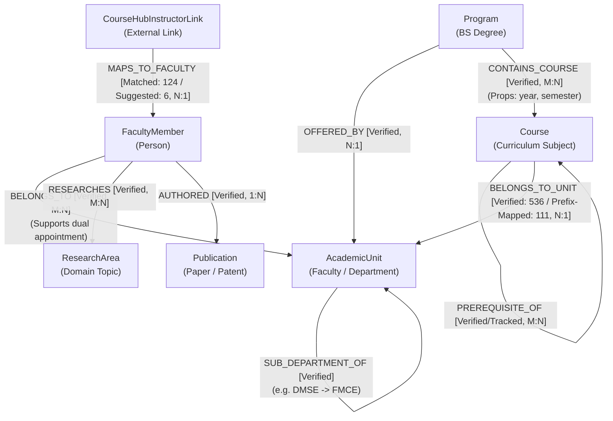

# GIKI Nexus: Academic Knowledge Graph Relationships

**Document Version:** 2.0.0  
**Status:** Graph Relationship Architecture Specification (Updated with Implemented Mappings)  
**Target:** Graph Modeling (Neo4j / NetworkX / Relational Join Tables)

---

## 1. Graph Architecture Overview

The academic component of GIKI Nexus is conceptually structured as a directed property graph representing entities (nodes) and their academic, structural, and intellectual relationships (edges).

This document evaluates each proposed relationship against the actual source data in `data/processed/`, specifies its cardinality, documents its supporting data sources, and classifies its verification status into:
- **Verified:** Fully substantiated by official website listings or validated catalog structures.
- **Derived / Prefix-Mapped:** Resolved via deterministic, anchored prefix matching rules (`unit_mapping_source = "prefix_based_mapping"`), pending human administrative confirmation.
- **Requires Manual Review:** Ambiguities, candidate matches, or broken dependencies identified during audit.
- **Unsupported (Private):** Data that is absent from public web pages and exists only in external/private databases.

---

## 2. Graph Schema Diagram

---

## 3. Relationship Specifications

### 3.1 `UNIT_SUB_DEPARTMENT_OF` (Self-referential Unit Hierarchy)
- **Start Node:** `AcademicUnit` (Sub-Department)
- **End Node:** `AcademicUnit` (Parent Faculty)
- **Cardinality:** Many-to-One
- **Meaning:** Represents the organizational structure where specialized engineering departments operate under a parent faculty.
- **Source Data:** `units.json` (`parent` field).
  - Department of Materials Science & Engineering (`dmse`) $\rightarrow$ Faculty of Materials and Chemical Engineering (`fmce`).
  - Department of Chemical Engineering (`dche`) $\rightarrow$ Faculty of Materials and Chemical Engineering (`fmce`).
- **Status:** **Verified (High Confidence).** Established directly by official GIKI institutional charter.

---

### 3.2 `MEMBER_BELONGS_TO_UNIT` / `UNIT_HAS_MEMBER`
- **Start Node:** `FacultyMember`
- **End Node:** `AcademicUnit`
- **Cardinality:** **Many-to-Many (M:N)**
- **Meaning:** Represents an instructor's or researcher's formal affiliation with one or more academic departments.
- **Source Data:** `faculty.json` (`units` list), scraped from official faculty roster pages (e.g. `/fcse/faculty-profiles/`).
- **Real-World University Complexity:**
  - Most faculty (180) belong to exactly one unit.
  - **Dual Appointment:** `prof-dr-nisar-ahmed` is officially affiliated with both the Faculty of Basic Sciences (`fbs`) and Faculty of Electrical Engineering (`fee`). The graph schema cleanly supports this via multiple `BELONGS_TO` edges.
  - **Unassigned Member:** `dr-asif-khan-assistant-professor` was listed on the general directory without a department card (`units: []`).
- **Status:** **Verified** for 180 faculty; **Requires Manual Review** for 1 faculty (`dr-asif-khan`).

---

### 3.3 `MEMBER_HAS_RESEARCH_AREA` / `RESEARCHES`
- **Start Node:** `FacultyMember`
- **End Node:** `ResearchArea`
- **Cardinality:** Many-to-Many (M:N)
- **Meaning:** Connects a researcher to their active fields of study and intellectual specializations.
- **Source Data:** `faculty.json` (`research_area_ids`), linked to `research_areas.json`.
- **Status:**
  - **Verified** for 157 faculty with structured bullet lists.
  - **Requires Manual Review** for 8 faculty whose interests exist only as narrative prose paragraphs (`research_summary`), and 16 faculty with no listed research interests.

---

### 3.4 `MEMBER_AUTHORED_PUBLICATION` / `AUTHORED`
- **Start Node:** `FacultyMember`
- **End Node:** `Publication`
- **Cardinality:** One-to-Many (1:N in current seed dataset; M:N in full co-authorship graph)
- **Meaning:** Links an academic citation to the faculty member on whose official profile it is listed.
- **Source Data:** `publications.json` (`faculty_id` $\rightarrow$ `FacultyMember.id`).
- **Status:** **Verified.** Parsed directly from faculty publications sections. 97 duplicate citations under the same author were removed, yielding 2,796 clean publication edges across 110 faculty members.

---

### 3.5 `PROGRAM_CONTAINS_COURSE` / `CONTAINS_COURSE`
- **Start Node:** `Program` (BS Degree)
- **End Node:** `Course`
- **Cardinality:** Many-to-Many (M:N)
- **Edge Properties:**
  - `year`: Integer (1, 2, 3, or 4)
  - `semester`: Integer (1 through 8)
  - `name_in_catalog`: String (Title under which the course is cataloged in that specific curriculum)
- **Meaning:** Defines the degree roadmap showing exactly which year and semester a course is scheduled within a program.
- **Source Data:** `courses.json` (`offered_in` list), extracted from CourseHub live curriculum snapshots.
- **Status:** **Verified** for 321 courses across all 15 BS programs.

---

### 3.6 `COURSE_HAS_PREREQUISITE` / `PREREQUISITE_OF`
- **Start Node:** `Course` (Target)
- **End Node:** `Course` (Prerequisite)
- **Cardinality:** Many-to-Many (M:N, Directed Acyclic Graph)
- **Meaning:** Indicates that completing the prerequisite course is required before enrolling in the target course.
- **Source Data:** `courses.json` (`prerequisites` list, parsed from `prerequisites_raw`).
- **Status:**
  - **Verified** for 261 course prerequisite dependencies.
  - **Preserved as Unresolved (Tracked in Catalog & Review Queue):** 5 prerequisite codes referenced across 6 courses that do not exist as top-level courses in the catalog snapshot:
    1. `AI321` (Prerequisite for `AI331` and `AI462` — FCSE curriculum renumbered Machine Learning to `AI221`)
    2. `MM102` (Prerequisite for `EE485` — possible variant of `MM101`)
    3. `MS290` (Prerequisite for `EE486` — MGS economics sequence)
    4. `ME101` (Prerequisite for `ME418` — introductory graphics/CAD)
    5. `ME261` (Prerequisite for `ME468` — machine design sequence)
- **Policy:** The 5 missing codes are retained verbatim in `Course.prerequisites`, marked as `"unresolved"` in `Course.prerequisite_statuses`, and logged in `needs_review.json` pending curriculum committee review.

---

### 3.7 `COURSE_BELONGS_TO_UNIT` / `OFFERED_BY`
- **Start Node:** `Course`
- **End Node:** `AcademicUnit`
- **Cardinality:** Many-to-One (N:1)
- **Meaning:** Identifies the academic department responsible for administering, staffing, and maintaining the course syllabus.
- **Source Data:** `courses.json` (`unit` field).
- **Status:**
  - **Prospectus-Verified:** 536 courses (`unit_mapping_source: "prospectus_verified"`).
  - **Derived via Prefix Rules:** 111 courses (`unit_mapping_source: "prefix_based_mapping"`).
  - **Unresolved:** 0 courses.
  - **Breakdown by Unit for Prefix Mappings:** `fcse`: 52, `fee`: 27, `dcve`: 17, `fbs`: 8, `dche`: 2, `fme`: 2, `mgs`: 2, `dmse`: 1.
  - **Administrative Note:** Prefix mappings are fully documented and marked in the review queue as resolved pending final human confirmation.

---

### 3.8 `PROGRAM_OFFERED_BY`
- **Start Node:** `Program`
- **End Node:** `AcademicUnit`
- **Cardinality:** Many-to-One (N:1)
- **Meaning:** Links each 4-year Bachelor of Science degree program to its parent academic faculty.
- **Source Data:** `programs.json` (`unit` field).
- **Status:** **Verified (High Confidence).** All 15 BS programs map cleanly to their host faculty.

---

### 3.9 `INSTRUCTOR_MAPS_TO_FACULTY` (External Link)
- **Start Node:** `CourseHubInstructorLink`
- **End Node:** `FacultyMember`
- **Cardinality:** Many-to-One (N:1)
- **Meaning:** Joins CourseHub instructor name strings with GIKI Nexus faculty profile slugs.
- **Source Data:** `coursehub_instructor_links.json`.
- **Status:**
  - **Matched:** 124 instructor mappings verified against official faculty profiles (`match_status: "matched"`).
  - **Suggested Candidates:** 6 high-probability matches (`match_status: "suggested"` with `suggested_faculty_id`, `faculty_id: null`).
  - **Needs Review:** 17 single-name instructor records (`match_status: "needs_review"`).
  - **Unmatched:** 43 unlisted instructors/TAs (`match_status: "unmatched"`).
  - All 190 records preserved without truncation.

---

### 3.10 `MEMBER_TEACHES_COURSE` (Deferred Relationship)
- **Start Node:** `FacultyMember`
- **End Node:** `Course`
- **Status:** **UNSUPPORTED BY PUBLIC DATA SNAPSHOT.**
- **Explanation:** Public GIKI web pages list faculty members under departments and list courses under programs, but **do not publish which specific faculty member teaches which course in which semester**. This operational data exists only inside CourseHub's private database (`course_instructors` table).
- **Policy:** In accordance with project instructions (*"Do not connect to CourseHub's database... Do not invent missing academic information or relationships"*), we do NOT invent `TEACHES` edges. This edge is intentionally omitted until an authorized, static read-only export of teaching assignments is provided.
