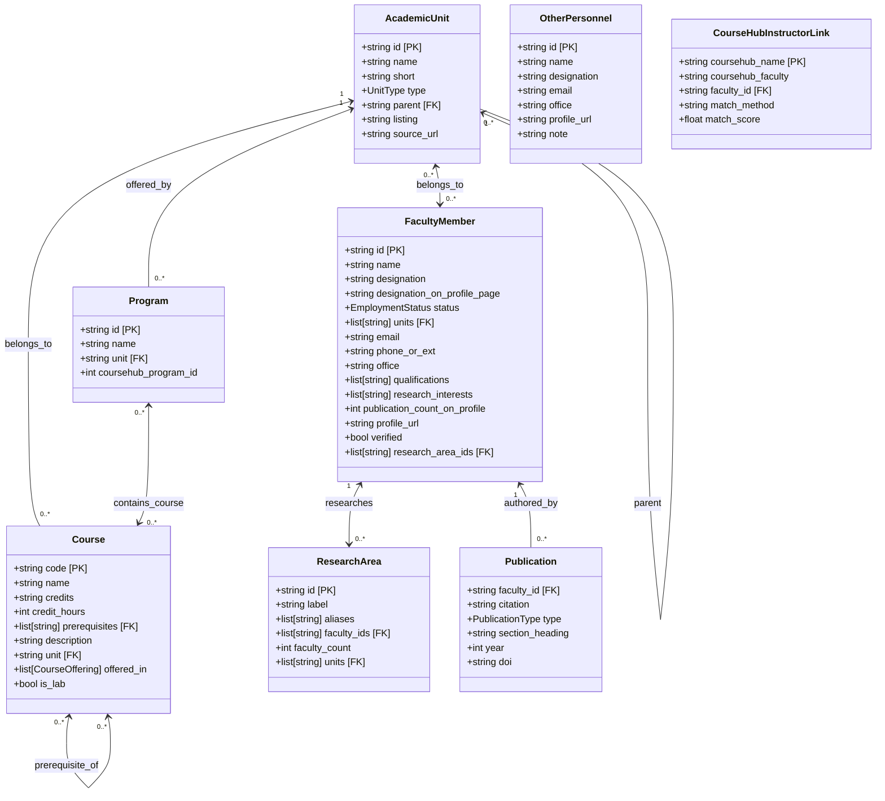

# GIKI Nexus: Domain Model Specifications

**Document Version:** 1.0.0  
**Status:** Proposed & Validated via Pydantic Schemas  
**Target Architecture:** GIKI Nexus Backend (Pre-Persistence Specification)  
**Implementation Reference:** `backend/app/schemas/domain.py`

---

## 1. Overview & Architectural Principles

This document specifies the core domain entities for **GIKI Nexus**, derived from actual scraped and cross-referenced GIKI academic datasets (`data/processed/`). 

### Key Design Principles:
1. **Decoupled from Persistence:** These models represent the logical domain entities and API schemas. They do not introduce database-specific drivers, ORM ties, or graph engine dependencies (e.g., Neo4j, SQLAlchemy, SQLite) in this initial phase.
2. **Zero-Invention Guarantee:** Fields that are absent in the source data remain nullable (`Optional[T] = None`) or empty collections (`List[T] = []`). Missing information is flagged explicitly rather than fabricated.
3. **Many-to-Many Support:** Models support real-world university complexities, such as faculty members holding joint/dual appointments across multiple faculties (e.g., Prof. Dr. Nisar Ahmed affiliated with FBS and FEE).
4. **Preserved Provenance:** Every top-level entity maintains origin URLs and scrape timestamps to preserve traceability back to official GIKI web pages and catalog snapshots.

---

## 2. Entity Specifications

---

### 2.1 AcademicUnit (Faculty, Department, School)

Represents organizational entities within GIKI. Accommodates both standalone faculties (FCSE, FEE, FME, FBS, MGS, DCvE) and sub-departments (DMSE and DChE under FMCE).

| Field Name | Type | Required | Unique ID | Description |
|---|---|---|---|---|
| `id` | `str` | **Yes** | **Primary Key** | Slug identifier (e.g. `"fcse"`, `"dmse"`, `"fmce"`). |
| `name` | `str` | **Yes** | No | Full official name (e.g. `"Faculty of Computer Science and Engineering"`). |
| `short` | `str` | **Yes** | No | Official acronym (e.g. `"FCSE"`, `"DMSE"`). |
| `type` | `UnitType` | **Yes** | No | Enum: `faculty`, `department`, or `school`. |
| `parent` | `Optional[str]` | No | Foreign Key | Parent unit `id` if sub-department; otherwise `None`. |
| `listing` | `Optional[str]` | No | No | Relative path of official faculty profile roster page. |
| `source_url`| `Optional[str]` | No | No | Absolute canonical URL of the department listing. |

- **Relationships:**
  - `parent`: Self-referential Many-to-One linking sub-departments to parent faculty (`dmse` $\rightarrow$ `fmce`).
  - `members`: Many-to-Many with `FacultyMember`.
  - `programs`: One-to-Many with `Program`.
  - `courses`: One-to-Many with `Course`.
- **Source / Provenance:** `units.json`, official GIKI website listing structures.

---

### 2.2 FacultyMember

Represents academic personnel (Professors, Associate Professors, Assistant Professors, Lecturers, and Lab Engineers) actively listed on official department rosters.

| Field Name | Type | Required | Unique ID | Description |
|---|---|---|---|---|
| `id` | `str` | **Yes** | **Primary Key** | Stable slug derived from `/personnel/<id>/` URL. |
| `name` | `str` | **Yes** | No | Sanitized full name with status markers removed. |
| `designation` | `Optional[str]` | No | No | Academic position title from department listing page. |
| `designation_on_profile_page` | `Optional[str]` | No | No | Position title stated on personal profile page. |
| `status` | `EmploymentStatus` | **Yes** | No | Enum: `active`, `on_leave`, `on_study_leave`. |
| `units` | `List[str]` | **Yes** | Foreign Key | List of `AcademicUnit.id` affiliations (supports joint/dual appointments). |
| `email` | `Optional[str]` | No | No | Cleaned, lowercased official email address. |
| `phone_or_ext` | `Optional[str]` | No | No | Telephone direct line or internal extension. |
| `office` | `Optional[str]` | No | No | Room number or building location. |
| `qualifications_raw` | `Optional[str]` | No | No | Unparsed qualifications text from profile page. |
| `qualifications` | `List[str]` | **Yes** | No | Structured degree and qualification credentials. |
| `qualifications_summary` | `Optional[str]` | No | No | Narrative qualification biography if in paragraph form. |
| `research_interests_raw` | `Optional[str]` | No | No | Unparsed research interests text. |
| `research_interests` | `List[str]` | **Yes** | No | Structured list of normalized research interests. |
| `research_summary` | `Optional[str]` | No | No | Narrative research summary if in paragraph form. |
| `bio` | `Optional[str]` | No | No | Biographical summary paragraph. |
| `publication_count_on_profile`| `int` | **Yes** | No | Total citation count extracted from personal profile. |
| `profile_sections` | `List[str]` | **Yes** | No | List of tab headings found on profile page. |
| `photo_url` | `Optional[str]` | No | No | Direct URL to portrait photograph. |
| `profile_url` | `str` | **Yes** | No | Canonical profile web URL on `giki.edu.pk`. |
| `listing_urls` | `List[str]` | **Yes** | No | List of official department listing pages where card appears. |
| `website_categories` | `List[str]` | **Yes** | No | WordPress category slugs associated with profile. |
| `prospectus_2025` | `Optional[ProspectusCrossCheck]` | No | No | Prospectus matching metadata and false-positive flag. |
| `provenance` | `ProvenanceMetadata` | **Yes** | No | Sources list and scrape timestamp. |
| `missing_fields` | `List[str]` | **Yes** | No | List of missing essential fields (`email`, `qualifications`, etc.). |
| `verified` | `bool` | **Yes** | No | True if officially listed AND qualifications & research on record. |
| `research_area_ids` | `List[str]` | **Yes** | Foreign Key | Foreign keys to `ResearchArea.id`. |

- **Relationships:**
  - `units`: Many-to-Many with `AcademicUnit` (e.g. `prof-dr-nisar-ahmed` $\in$ `['fbs', 'fee']`).
  - `research_areas`: Many-to-Many with `ResearchArea`.
  - `publications`: One-to-Many with `Publication`.
- **Source / Provenance:** `faculty.json`, scraped from `giki.edu.pk` listings and personnel pages.

---

### 2.3 Course

Represents academic courses across undergraduate and graduate curricula.

| Field Name | Type | Required | Unique ID | Description |
|---|---|---|---|---|
| `code` | `str` | **Yes** | **Primary Key** | Standardized course code (e.g. `"CS101"`, `"CS3XX/CS4xx"`). |
| `name` | `Optional[str]` | No | No | Full course title. |
| `credits` | `Optional[str]` | No | No | Standardized lecture-lab-credit format (`"3-0-3"`). |
| `credit_hours` | `Optional[int]` | No | No | Total credit hours as integer (e.g. `3`). |
| `prerequisites` | `List[str]` | **Yes** | Foreign Key | List of prerequisite `Course.code` values. |
| `prerequisites_raw` | `Optional[str]` | No | No | Verbatim prerequisite clause from catalog. |
| `description` | `Optional[str]` | No | No | Course syllabus and topic summary. |
| `unit` | `Optional[str]` | No | Foreign Key | Foreign key to `AcademicUnit.id` (nullable for 111 unassigned courses). |
| `offered_in` | `List[CourseOffering]` | **Yes** | Composite | Program curricula offering this course with year & semester. |
| `is_lab` | `bool` | **Yes** | No | True if course represents a laboratory session. |
| `provenance` | `ProvenanceMetadata` | **Yes** | No | Origin document citations (Prospectus page, live catalog). |

- **Relationships:**
  - `unit`: Many-to-One with `AcademicUnit`.
  - `prerequisites`: Many-to-Many self-referential directed graph (`Course` $\rightarrow$ `Course`).
  - `programs`: Many-to-Many via `CourseOffering` edges containing `(program_id, year, semester)`.
- **Source / Provenance:** `courses.json`, derived from Prospectus 2025 and live catalog snapshots.

---

### 2.4 Program

Represents four-year Bachelor of Science (BS) degree programs.

| Field Name | Type | Required | Unique ID | Description |
|---|---|---|---|---|
| `id` | `str` | **Yes** | **Primary Key** | Program slug (e.g. `"bs-computer-science"`). |
| `name` | `str` | **Yes** | No | Official program title (e.g. `"BS Computer Science"`). |
| `unit` | `str` | **Yes** | Foreign Key | Foreign key to offering `AcademicUnit.id`. |
| `coursehub_program_id` | `Optional[int]` | No | No | Identifier from CourseHub catalog snapshot. |

- **Relationships:**
  - `unit`: Many-to-One with `AcademicUnit`.
  - `courses`: Many-to-Many with `Course` via curriculum semester grids.
- **Source / Provenance:** `programs.json`, CourseHub static catalog snapshot.

---

### 2.5 ResearchArea

Represents aggregated, normalized research topics across university faculty.

| Field Name | Type | Required | Unique ID | Description |
|---|---|---|---|---|
| `id` | `str` | **Yes** | **Primary Key** | Slug identifier (e.g. `"computational-fluid-dynamics"`). |
| `label` | `str` | **Yes** | No | Canonical display name (punctuation trimmed). |
| `aliases` | `List[str]` | **Yes** | No | Variant spellings, synonyms, and raw input labels. |
| `faculty_ids` | `List[str]` | **Yes** | Foreign Key | Foreign keys to associated `FacultyMember.id`. |
| `faculty_count`| `int` | **Yes** | No | Number of active faculty associated with this area. |
| `units` | `List[str]` | **Yes** | Foreign Key | Foreign keys to `AcademicUnit.id` conducting research in this area. |

- **Relationships:**
  - `faculty`: Many-to-Many with `FacultyMember`.
  - `units`: Many-to-Many with `AcademicUnit`.
- **Source / Provenance:** `research_areas.json`, aggregated from faculty profile text.

---

### 2.6 Publication

Represents citations of papers, book chapters, conference presentations, and patents authored by faculty.

| Field Name | Type | Required | Unique ID | Description |
|---|---|---|---|---|
| `faculty_id` | `str` | **Yes** | Foreign Key | Foreign key to `FacultyMember.id`. |
| `citation` | `str` | **Yes** | Composite Key | Verbatim citation string as listed on faculty profile. |
| `type` | `PublicationType` | **Yes** | No | Enum: `journal`, `conference`, `book_or_chapter`, `patent`, `unspecified`. |
| `section_heading` | `Optional[str]` | No | No | Heading on profile page under which paper appeared. |
| `year` | `Optional[int]` | No | No | Extracted publication year (4 digits). |
| `doi` | `Optional[str]` | No | No | Digital Object Identifier string. |

- **Relationships:**
  - `author`: Many-to-One with `FacultyMember` (future multi-author expansion supported).
- **Source / Provenance:** `publications.json`, extracted from faculty profile pages.

---

### 2.7 OtherPersonnel

Represents personnel profiles present on `giki.edu.pk/personnel/` that do not belong to active faculty rosters (board members, marketing staff, former or deceased faculty).

| Field Name | Type | Required | Unique ID | Description |
|---|---|---|---|---|
| `id` | `str` | **Yes** | **Primary Key** | Personnel slug identifier. |
| `name` | `str` | **Yes** | No | Full name. |
| `designation` | `Optional[str]` | No | No | Stated role or job title. |
| `email` | `Optional[str]` | No | No | Email address if available. |
| `office` | `Optional[str]` | No | No | Office location. |
| `profile_url` | `str` | **Yes** | No | Canonical web URL on `giki.edu.pk`. |
| `note` | `str` | **Yes** | No | Explanation of why person is excluded from active faculty graph. |
| `provenance` | `ProvenanceMetadata` | **Yes** | No | Origin sources and scrape timestamp. |

- **Source / Provenance:** `other_personnel.json`.

---

### 2.8 CourseHubInstructorLink

Represents the alignment mapping between CourseHub instructor name strings and GIKI Nexus faculty IDs.

| Field Name | Type | Required | Unique ID | Description |
|---|---|---|---|---|
| `coursehub_name` | `str` | **Yes** | **Primary Key** | Exact instructor name string from CourseHub catalog. |
| `coursehub_faculty` | `Optional[str]` | No | No | Faculty department string in CourseHub. |
| `faculty_id` | `Optional[str]` | No | Foreign Key | Matched `FacultyMember.id` (`None` if unmatched). |
| `match_method` | `Optional[str]` | No | No | Matching strategy (`full_name`, `unique_partial_name`, `None`). |
| `match_score` | `Optional[float]` | No | No | Similarity confidence score (0.0 to 1.0). |

- **Relationships:**
  - `faculty`: Optional Many-to-One with `FacultyMember`.
- **Source / Provenance:** `coursehub_instructor_links.json`.
